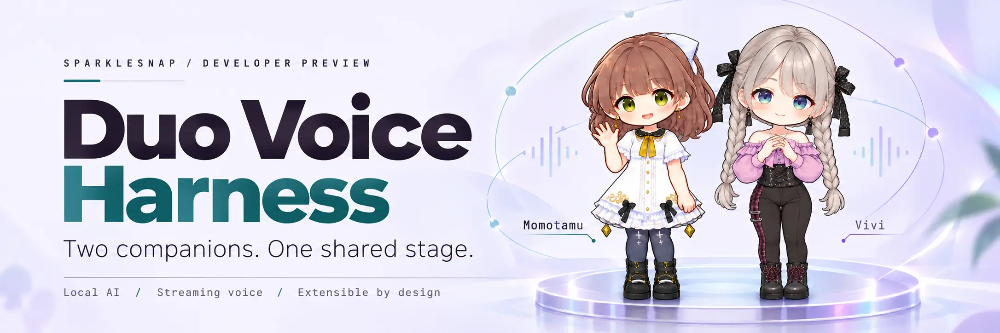

<div align="center">



# Duo Voice Harness

**A shared stage. Two companions. A conversation you can join.**

Momotamu & Vivi · Local-first AI · Windows desktop

[Get started](#get-started) · [Meet the conversation](#meet-the-conversation) · [Setup](#set-up-your-engines) · [Verification](#verification) · [Behind the scenes](#behind-the-scenes) · [Contribute](CONTRIBUTING.md)

</div>

---

Duo Voice Harness brings Momotamu and Vivi together above your conversation on Windows desktop. Type a thought, speak into your microphone, or address one companion directly. Conversation can run on local Gemma via llama.cpp or an OpenAI-compatible endpoint. Spoken replies are a separate choice: local VoiceGen Oui / VoxCPM2, a DIY speech server, ElevenLabs, Cartesia, or Text only.

The character stage stays anchored at the top, with the transcript beneath it and your composer within reach. In a duet, the companions face each other. On her own, a companion faces you.

> **A little kawaii. A lot of interaction design. (｡•̀ᴗ-)✧**
>
> Momotamu and Vivi give the conversation a face—and a shared stage. Their poses, facing directions and speaking cues help you follow who’s talking while bringing a little personality to your desktop. Cute, with a purpose. This is Duo’s approach to human–computer interaction (HCI). [Explore the design thinking →](docs/HCI-DESIGN.md)

## See it in action

> ▶ **[Watch the 28-second intro video (MP4)](docs/media/duo-voice-harness-intro.mp4)**
>
> <sub>Momotamu and Vivi, prompt templates, and the local stage in motion. Music: “Neon Sparkle Dream” from SparkleSnap.</sub>

## Why I built this

Duo brings together **five months of self-directed learning and building with AI tools**. I have been teaching myself how to guide coding agents, turn ideas into working interfaces, integrate local models, and carry a project through iteration, debugging and review.

My contribution is the direction and integration of the experience: the two-character stage, conversation and audio flows, local runtime coordination, visual feedback, and bringing those pieces together. AI coding agents have been collaborators throughout. Upstream components and their licenses are credited in [NOTICE](NOTICE).

Duo is a **developer preview** for collaboration, experimentation, and feedback.

## Meet the conversation

**Momotamu ✿** brings warm curiosity. **Vivi ✧** brings quick wit. Say hello, pick a topic, and give them something to discuss. (´｡• ᵕ •｡`)

| You want to… | In Duo |
| --- | --- |
| Start a conversation | Enter a topic and send it, or click a template above the message box. |
| Hear from Vivi first | Try **“Vivi, what do you think?”** (or **“Vivian…”**). Direct address chooses the opening speaker. |
| Talk with Momotamu alone | Select **Momotamu** (or call her **Tammy**). Select **+ Vivi** to bring the duet back. |
| Try a prepared scene | **Roast**, **Academic Duel**, **Comedy Skit**, or **Deep Dive**. **Random topic** can fill the blank. |
| Practice Japanese | **Kanji Story**, **Phrase Lab**, or **Micro Recall**. Each companion keeps her own voice. |
| Choose who they speak to | With both companions on, **Listener** offers **Speak with us** or **Speak to each other** (2 to 12 turns). |
| Speak instead of type | **Hold to talk** sends the recording to Gemma. **Dictate** writes words into the field with Windows speech. |
| Interrupt a spoken reply | Enable **Hands-free**. Sustained speech stops playback and sends your new question. |
| Make a standalone voice take | Open **Activities → Speech**, enter your words, then generate, replay, or save the WAV take. |
| Ground replies on a text | Click **Document** below the composer. See the [Document Grounding Guide](docs/DOCUMENTS.md). |
| Share notes across chats | Open the **Worktree** panel to maintain shared `context.md` project notes. |
| Reopen past conversations | Reopen any previous solo chat or duo discussion from the header dropdown. |

> [!TIP]
> **Voice Nicknames:** Speech-to-text models can sometimes mishear Japanese-style fantasy names. You can address **Momotamu** as **“Tammy”** (or *“Momo”*) and **Vivi** as **“Vivian”** (or *“Viv”*)—the routing engine and companions recognize both seamlessly!

**The Stage:** Open **View → Cyberpunk** for a dark 3D wireframe lattice with real-time RAG HUD telemetry and conduit lighting. Choose **Side view** for compact secondary displays (enlarged text, 96×96 cursor, scrollable controls).

## Get started

**Windows 10/11 x64 · Developer preview 0.1.0-preview.1 · Node.js 22.12+**

Double-click **[Start-Duo-Voice.cmd](Start-Duo-Voice.cmd)**, or run:

```powershell
npm ci
npm start
```

The launcher installs locked dependencies, downloads Electron on first run, and logs startup errors. For a read-only environment check before downloading models, run **`npm run doctor`**.

## Set up your engines

1. **Language Model:** Install the pinned Windows Vulkan llama.cpp runtime:
   ```powershell
   npm run setup:llama
   ```
   Open **Local engines → AI model setup**, select the Gemma 4 12B QAT GGUF and its audio projector, and click **Load AI model**. An OpenAI-compatible endpoint can also be configured under Connection settings.
2. **Voice Backend:** Open **Settings → Voices** to configure speech output:
   - **Local VoiceGen Oui / VoxCPM2:** WSL2 with ROCm Python environment and VoxCPM2 weights.
   - **DIY Speech Server:** Connect any custom HTTP server adhering to Duo's versioned streaming contract (or run `npm run diy:server` for an instant zero-GPU test tone demo).
   - **ElevenLabs / Cartesia:** Connect your provider account with OS-protected credentials.
   - **Text Only:** Chat without speech synthesis.
   See the [Voice Setup Guide](docs/VOICE-SETUP.md) for setup instructions. **Persona → Voice → Choose language…** offers 39 language and dialect choices; synthesis support and pronunciation depend on your provider and model.

> [!NOTE]
> The featured local VoiceGen Oui route uses AMD ROCm in WSL2. **Text only**, a **DIY Speech Server**, and hosted **ElevenLabs / Cartesia** adapters offer other speech configurations on supported Windows systems. Conversation still needs a configured language model.
3. **Audio & Calibration:** Choose your microphone and speakers in **Settings → Audio**, then run **Calibrate room & speakers**. Use headphones for optimal hands-free interruption.

## Verification

After installing the project dependencies, run the unit and Electron fixture suites without paid API credentials or running model servers:

```powershell
npm test          # Run unit and regression tests
npm run check     # Run unit tests + 9 Electron integration suites with synthetic services
```

Detailed test commands, synthetic fixture architecture, and manual verification steps are documented in the [Verification Suite](docs/VERIFICATION.md).

## Behind the scenes

Duo Voice Harness is a developer preview that brings together five months of self-directed learning and coding-agent collaboration. For curious developers and contributors looking deeper under the hood:

- **[The Making of Duo](docs/THE-MAKING-OF-DUO.md):** The story behind the project: five months of self-directed learning, pair-programming with AI coding agents, and architecture choices.
- **[HCI & Character Design Rationale](docs/HCI-DESIGN.md):** Emotional design, inspiration from kawaii research, and visual turn-taking cues.
- **[Data, Storage & Privacy](docs/DATA-AND-STORAGE.md):** Local session files, in-memory audio caching, and DPAPI credential protection.
- **[Document Grounding Guide](docs/DOCUMENTS.md):** CPU relevance checks, source-focused prompts, refusal handling, and their limits.
- **[Asset Provenance](docs/ASSET-PROVENANCE.md):** Provenance audit of character illustrations, audio references, and texture assets.

## Build with me

Issues, ideas, and pull requests are warmly welcome! Read [The Making of Duo](docs/THE-MAKING-OF-DUO.md) for architectural direction and the [Contributor Guide](CONTRIBUTING.md) to set up your environment and add new adapters.

Please share synthetic examples and mock data rather than private conversations or sensitive API keys.

Bring your curiosity, your bug reports, or your next “what if?” Let’s see what we can build together. ヽ(・∀・)ﾉ

## License & character use

- **Application Code & Motion Logic:** **[MIT](LICENSE)** (see component exceptions in **[NOTICE](NOTICE)** and **[runtime/voicegen-oui/ORIGIN.md](runtime/voicegen-oui/ORIGIN.md)**).
- **Momotamu, Vivi & Audio References:** Subject to the separate **[Character Guidelines](CHARACTER-GUIDELINES.md)** and **[Asset Provenance](docs/ASSET-PROVENANCE.md)**.
